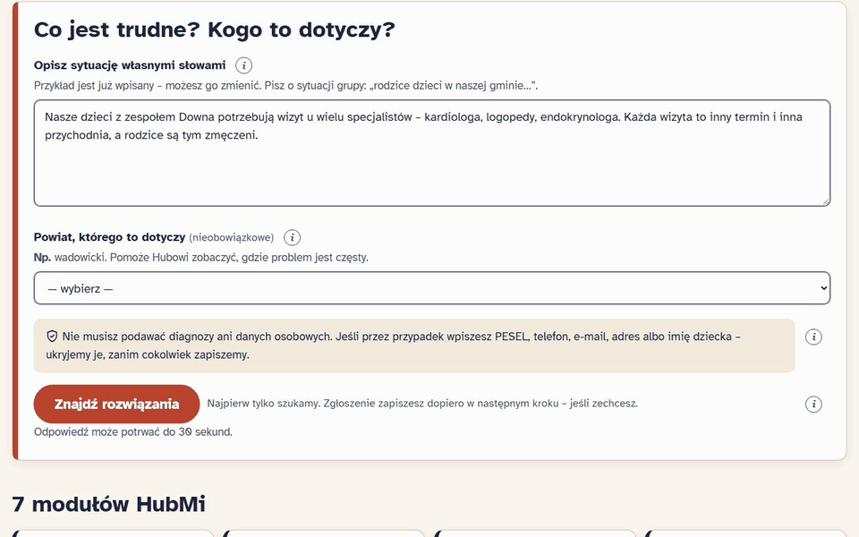

# HugMe – dopasowanie problemów mieszkańców do istniejących innowacji społecznych

**Mieszkaniec, gmina albo organizacja opisuje problem własnymi słowami i dostaje sprawdzone rozwiązania z regionu,
a Hub Innowacji Społecznych widzi, gdzie rozwiązań brakuje.** Prototyp dla Małopolskiego Hubu Innowacji Społecznych
(ROPS w Krakowie), HackYeah 2026.

[](https://github.com/TomaszWu14/hugme/actions/workflows/ci.yml)



📹 [Prezentacja działania – 1:46 (MP4, z lektorem)](docs/film/hugme-portfolio.mp4) · [napisy](docs/film/hugme-portfolio.srt) · YouTube: `<DO UZUPEŁNIENIA: link>`

🌐 **Demo:** [hugme.twapp.pl](https://hugme.twapp.pl) – konta bez haseł, rolę wybierasz w pasku u góry, dane odnawiają
się po 20 minutach ciszy. Demo może zostać wyłączone bez zapowiedzi – wtedy
uruchom aplikację lokalnie (instrukcja niżej, ok. 2 minuty).

## Problem → rozwiązanie

W regionie działa wiele innowacji społecznych, ale ludzie, którzy ich potrzebują, o nich nie wiedzą, gmina obok
buduje od zera to, co już działa, a Hub nie widzi, gdzie pomocy brakuje. HugMe przyjmuje opis problemu w zwykłym
języku, ukrywa dane osobowe i dopasowuje go do Biblioteki Innowacji regułami, które da się wyjaśnić („pasuje, bo:
wspólne słowa i tematy”). Zapisane zgłoszenie trafia do Hubu jako wątek, autor ocenia trafność, a zgłoszenia bez
dobrego rozwiązania stają się **lukami** – danymi do tematów kolejnych naborów.

## Dokumentacja analityczna

| Dokument | Co zawiera |
|---|---|
| [01 – Problem i zakres](docs/01-problem-i-zakres.md) | problem, interesariusze, mierniki, co jest w zakresie i co poza nim – z uzasadnieniem |
| [02 – Proces](docs/02-proces.md) | proces PRZED i PO (Mermaid), punkty decyzyjne, wejścia/wyjścia, integracje i zachowanie przy awarii |
| [03 – User flow](docs/03-user-flow.md) | mapa 63 ekranów i przejść (3 diagramy + tabela), ścieżki alternatywne i ślepe |
| [04 – Model danych](docs/04-model-danych.md) | ERD 22 tabel, reguły integralności, niespójności model ↔ kod, dane osobowe w modelu |
| [05 – Wymagania](docs/05-wymagania.md) | 38 wymagań funkcjonalnych i 9 niefunkcjonalnych z kryteriami akceptacji, miejscem w kodzie i testem |
| [06 – Decyzje](docs/06-decyzje.md) | 11 decyzji: kontekst, rozważane opcje, dlaczego ta, skutki |
| [07 – Ograniczenia](docs/07-ograniczenia.md) | czego nie ma, 16 znanych problemów jako pytania analityka, co dalej |

Uzupełniające: [architektura](docs/ARCHITEKTURA.md) · [dane i RODO](docs/DANE.md) · [dostępność](docs/WCAG.md) ·
[raport axe](docs/WCAG_RAPORT.md) · [koszty](docs/KOSZTY.md) · [roadmapa](docs/ROADMAPA.md) ·
[materiały z hackathonu](docs/archiwum/).

## Jak uruchomić

Wymagany Python 3.12 lub nowszy (sprawdzone na 3.12 w CI i 3.13 lokalnie).

```bash
git clone https://github.com/TomaszWu14/hugme.git && cd hugme
python -m venv .venv && . .venv/bin/activate        # Windows: .venv\Scripts\activate
pip install -r requirements.txt -r requirements-dev.txt
DEMO_ACCOUNTS=1 flask --app app:create_app run      # Windows PowerShell: $env:DEMO_ACCOUNTS=1; flask --app app:create_app run
```

Aplikacja: http://127.0.0.1:5000. Przy pierwszym starcie baza `instance/hugme.db` tworzy się sama z danymi
przykładowymi; reset danych = usunięcie pliku bazy. Najszybszy przegląd: `/demo` – dwa scenariusze krok po kroku.

- **Windows:** sklonuj repo do krótkiej ścieżki (np. `C:\dev\hugme`). Pakiet `anthropic` ma bardzo długie nazwy plików
  i `pip install` w głęboko zagnieżdżonym katalogu kończy się błędem `OSError` (limit 260 znaków), chyba że
  włączysz w systemie obsługę długich ścieżek.
- **Zmienne środowiskowe:** `flask run` nie czyta pliku `.env` – ustaw je w powłoce. Plik `.env` (wzór: `.env.example`)
  czyta tylko `docker compose`.

```bash
pytest                                      # 376 testów: ścieżki, role, CSRF, prywatność, trafność, AI
python -m playwright install chromium
python scripts/axe_audit.py --zrzuty         # audyt dostępności + zrzuty ekranów
SECRET_KEY=$(python -c "import secrets;print(secrets.token_hex(32))") docker compose up -d --build   # Docker
```

## Konfiguracja

Wszystko przez zmienne środowiskowe; bez żadnej aplikacja startuje lokalnie z danymi przykładowymi i bez AI.

| Zmienna | Domyślnie | Do czego |
|---|---|---|
| `SECRET_KEY` | losowy przy każdym starcie | Podpis sesji i tokenów CSRF. **Na serwerze ustaw stały** – inaczej restart wylogowuje wszystkich. `docker-compose.yml` go wymaga. |
| `DATABASE` | `instance/hugme.db` (w obrazie `/data/hugme.db`) | Ścieżka pliku SQLite; czyta ją też `scripts/reset_demo.py`. |
| `COOKIE_SECURE` | wyłączone (w obrazie `1`) | `1` = ciasteczko sesji tylko po HTTPS. |
| `DEMO_MODE` | wyłączone | `1` = publiczne demo: konta z paska „Tryb demo” nie do zablokowania ani zmiany roli, przyciski „Napisz jako…” jednym kliknięciem dla gościa, komunikat o odnawianiu demo. |
| `DEMO_ACCOUNTS` | wyłączone (włączone, gdy `DEMO_MODE=1`) | `1` = konta demo bez haseł (pasek „Tryb demo”, `/konto`, scenariusze `/demo`) bez reszty trybu demo – do pracy lokalnej. Bez tej flagi i bez `DEMO_MODE` przełącznik zwraca 404. |
| `ANTHROPIC_API_KEY` | brak | Włącza funkcje AI. Bez klucza działają reguły i szablony. |
| `ANTHROPIC_MODEL` | `claude-haiku-4-5` | Model używany przez `core/ai.py`. |
| `AI_DAILY_LIMIT` | `300` | Dzienna pula wywołań AI (licznik w bazie, wspólny dla workerów); po wyczerpaniu szablony do północy UTC. |
| `AI_DISABLED` | wyłączone | `1` = AI wyłączone mimo klucza (testy i audyt axe ustawiają to same). |

**Reset publicznego demo.** `python scripts/reset_demo.py` czyści dane i ładuje seed, ale tylko po co najmniej
20 minutach bez nowych wpisów (żeby nie skasować oglądającemu tego, co przed chwilą zapisał); `--force` resetuje od razu.
Licznik AI zostaje. Na produkcji: Coolify → Scheduled Tasks, np. co godzinę. Lokalnie najprościej usunąć plik bazy.

## Stack i dlaczego taki

| Element | Dlaczego |
|---|---|
| **Python 3.12 + Flask + Jinja** | strony renderowane na serwerze działają bez JavaScriptu – na starszych telefonach i z czytnikami ekranu; 3 zależności produkcyjne (`flask`, `gunicorn`, `anthropic`) ([D-07](docs/06-decyzje.md#d-07-strony-renderowane-na-serwerze-pełne-działanie-bez-javascriptu)) |
| **BM25 + własny stemming + słownik pojęć** | dopasowanie wyjaśnialne, deterministyczne i testowalne, bez kosztu i bez klucza API ([D-01](docs/06-decyzje.md#d-01-dopasowanie-liczą-reguły-bm25-ai-tylko-poszerza-zapytanie)) |
| **Claude Haiku – opcjonalnie** | poszerza zapytanie i pisze teksty pomocnicze; nigdy nie decyduje; bez klucza działają reguły i szablony |
| **SQLite, schemat zgodny z PostgreSQL** | jeden plik w wolumenie wystarcza na prototyp; migracja opisana ([D-08](docs/06-decyzje.md#d-08-sqlite-w-wolumenie-schemat-zgodny-z-postgresql)) |
| **Docker + Coolify** | jeden kontener z healthcheckiem; wdrożenie po scaleniu do `main` |
| **pytest + axe-core (Playwright) w CI** | 376 testów i audyt dostępności blokują scalenie zmiany, która psuje ścieżkę albo WCAG |

## Zakres i ograniczenia

To prototyp z hackathonu, nie system produkcyjny. Świadomie **nie ma**: prawdziwego logowania (konta demo bez haseł),
wysyłki e-maili (kolejka w panelu), obsługi złożonego wniosku przez Hub (świadomie poza zakresem prototypu), usuwania danych przez użytkownika.
AI nigdy nie podejmuje decyzji, a karty usług nie zawierają kwot. Dane są fikcyjne (plakietka PRZYKŁAD), poza
miejscami pracy i statystykami w zakładce „Praca”, które mają źródła. Trafność zmierzona na 16 zdaniach testowych.
Szczegóły i 16 znanych problemów: [07 – Ograniczenia](docs/07-ograniczenia.md).

## Kontekst projektu

Projekt zrobiłem sam w czasie HackYeah 2026 (zadanie HubMi.pl, oddanie 4 października 2026), a potem uporządkowałem.
Decyzje produktowe zapadały w ustrukturyzowanych sesjach pytań ([archiwum/BRAINSTORM.md](docs/archiwum/BRAINSTORM.md)).
Kod pisałem z Claude Code jako asystentem programisty – decyzje, dane, testy i weryfikacja są moje, a commity mają
jawny dopisek `Co-Authored-By: Claude`.

**Ocena jury HackYeah 2026** (zadanie partnerskie UMWM: HubMi.pl):

| Kryterium | Ocena |
|---|---|
| Stopień spełnienia wyzwania | 7,67 |
| Potencjał wdrożeniowy | 7,00 |
| Dostępność i intuicyjność prototypu | 7,00 |
| Atrakcyjność, pomysłowość i jakość interfejsu | 7,00 |
| Jakość dostarczonych materiałów oraz MVP | 7,33 |
| **Średnia** | **7,30** (średnia wszystkich zespołów: 5,65) |

**Moja rola:** cały zespół to jedna osoba. Przeanalizowałem brief HubMi.pl, podjąłem decyzje produktowe przed
kodowaniem (100 pytań i odpowiedzi w [BRAINSTORM](docs/archiwum/BRAINSTORM.md)), zamieniłem reguły biznesowe na testy
akceptacyjne (376 testów) i zweryfikowałem działanie; kod powstał z Claude Code jako asystentem programisty.

## Prawa

Kod jest mój i jest udostępniony na licencji [MIT](LICENSE). Dane przykładowe są fikcyjne; miejsca pracy
i statystyki w zakładce „Praca” pochodzą z publicznych źródeł podanych przy każdym wpisie.
