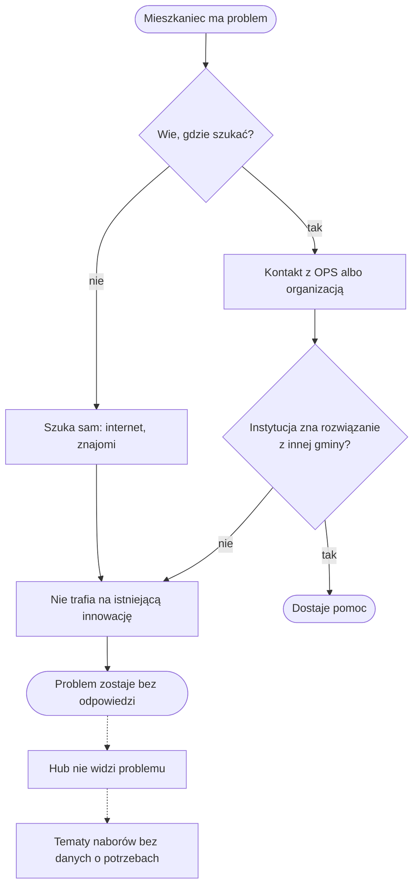
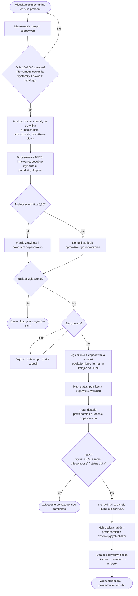
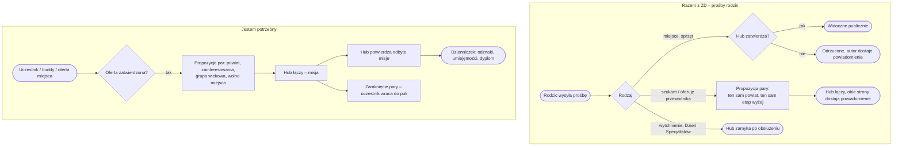

# 02. Proces biznesowy

## Aktorzy

Mieszkanka-rodzic, organizacja pozarządowa, gmina, ekspert, koordynatorka Hubu ROPS (administrator), gość.
System: opcjonalny model AI (Claude) – wyłącznie dopisuje tekst, nie podejmuje decyzji.

## PRZED – bez aplikacji

> Poniższy diagram to **hipoteza** zbudowana z opisu problemu, nie z badań – brak danych o procesie sprzed
> aplikacji. Do potwierdzenia albo poprawy w rozmowie z Hubem (pierwszy krok pilotażu).

Punkty bólu: brak jednego miejsca do opisania problemu, wiedza o innowacjach rozproszona po instytucjach,
brak informacji zwrotnej do Hubu.

## PO – z aplikacją

### Punkty decyzyjne

| Decyzja | Kto | Reguła | Kod |
|---|---|---|---|
| Czy opis wystarczy? | system | 15–1500 znaków; do szukania 1 słowo znane z katalogu | `app/views/public.py` `validate_search` |
| Czy coś pasuje? | system | najlepszy wynik ≥ 0,35 | `core/domain.py` `GAP_THRESHOLD` |
| Czy zgłoszenie jest publiczne? | Hub | pole „Opublikuj” przy zmianie statusu | `app/views/admin.py` `set_status` |
| Czy to luka? | system + Hub | wynik < 0,35 lub same „niepomocne” lub status „luka” | `app/views/admin.py` `gaps` |
| Czy nabór jest otwarty? | Hub | przełącznik; generator wniosków działa tylko w otwartym naborze przed terminem | `app/views/kreator.py` `application` |

### Wejścia i wyjścia

| Krok | Wejście | Wyjście |
|---|---|---|
| Szukanie | opis, opcjonalnie powiat | lista dopasowań z etykietą i wyjaśnieniem (szkic w sesji) |
| Zapis | szkic, konto | zgłoszenie, do 5 dopasowań w `matches`, wątek, powiadomienie Hubu |
| Decyzja Hubu | zgłoszenie | status, publikacja, powiadomienie autora |
| Ocena autora | dopasowanie | `matches.feedback` = 1 / −1 → miernik trafności |
| Analiza Hubu | wszystkie zgłoszenia | trendy, luki, CSV |

## Procesy w pilotażu „Razem z ZD”

## Integracje

| Integracja | Kierunek | Format | Gdy nie odpowiada |
|---|---|---|---|
| Claude (Anthropic API) | wyjście: tekst po maskowaniu w ogranicznikach; wejście: tekst lub JSON | HTTPS, SDK `anthropic` | timeout 25 s bez ponowień, dzienny limit wywołań, odpowiedź spoza schematu odrzucona → reguły i szablon; nigdy błąd 500 |
| `POST /api/v1/dopasuj` | wejście: opis → wyjście: dopasowania | JSON | bez AI; walidacja 400 / 422 |
| `GET /api/v1/innowacje` | wyjście: Biblioteka z filtrami | JSON | nieznany filtr → 400 z listą dozwolonych wartości |
| Import Biblioteki | wejście (panel Hubu) | CSV (`,` lub `;`, UTF-8) albo JSON | raport błędów dla każdego wiersza; duplikaty tytułów pomijane |
| Eksport | wyjście | CSV `;` z BOM, ochrona przed formułami | – |
| E-mail | wyjście | wiersz w tabeli `emails` | **nie jest wysyłany** – brak workera SMTP |
| YouTube | osadzenie filmu w karcie innowacji | iframe youtube-nocookie | brak linku → brak filmu |
