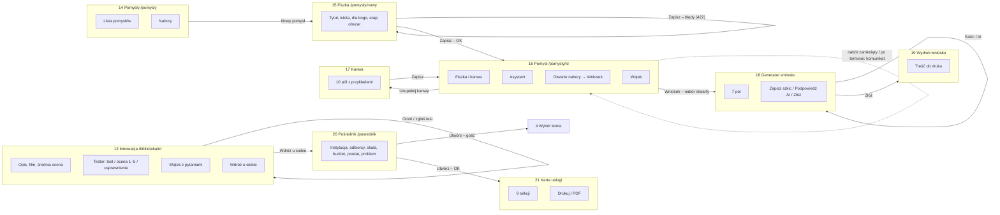
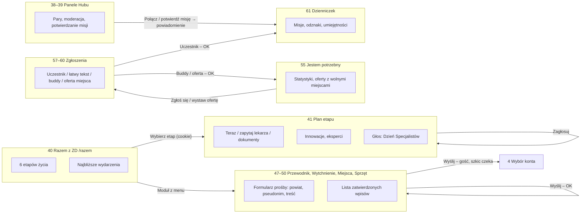

# 03. User flow – mapa ekranów i przejść

Aplikacja ma 63 ekrany (widoki GET) i 95 tras. Wszystko to pełne strony renderowane na serwerze – nie ma modali
ani pojedynczej aplikacji JS, więc każde przejście to zwykły link albo formularz.

**Elementy wspólne dla każdego ekranu:** pasek „Tryb demo” (wybór konta, A+ większy tekst, wysoki kontrast,
Podpowiedzi wł./wył., Wyloguj), menu 7 modułów + „Razem z ZD · pilotaż”, dzwonek z liczbą nowych powiadomień,
stopka (Deklaracja dostępności, Prywatność, Dane otwarte – API).

## Diagram 1. Rdzeń: matchmaking → zgłoszenie → Hub

```mermaid
flowchart LR
    subgraph S1["1 Start /"]
        s1a["Pole: Co jest trudne? Kogo to dotyczy?"]
        s1b[Lista: powiat]
        s1c[Przycisk: Znajdź rozwiązania]
        s1d[2 scenariusze demo]
        s1e[Kafle 7 modułów]
    end
    subgraph S2["2 Wyniki /wyniki"]
        s2a["Rozwiązania z etykietą i %"]
        s2b[Komunikat o ukrytych danych]
        s2c["Podobne zgłoszenia, poradniki, eksperci"]
        s2d[Formularz: Zapisz zgłoszenie]
    end
    subgraph S4["4 Wybór konta /konto"]
        s4a[Lista kont demo]
    end
    subgraph S3["3 Zgłoszenie /zgloszenie/id"]
        s3a["Status, obszar, powiat"]
        s3b["Dopasowania + Czy to pomocne?"]
        s3c[Wątek z Hubem]
        s3d["Tylko Hub: status + Opublikuj"]
    end
    subgraph S5["5 Moje sprawy /moje"]
        s5a[Zgłoszenia z odpowiedzią Hubu na górze]
        s5b["Pomysły, testy, obserwowane obszary"]
    end
    subgraph S6["6 Powiadomienia"]
        s6a[Lista]
        s6b[Oznacz wszystkie jako przeczytane]
    end
    subgraph S27["27 Panel Hubu /admin"]
        s27a[Statystyki]
        s27b[Skrzynka z filtrem typu]
    end
    subgraph S33["33 Trendy i luki /admin/trendy"]
        s33a["Obszar: 30 dni vs poprzednie 30"]
        s33b["Mapa powiat × obszar"]
        s33c["Luki z powodami + eksport CSV"]
    end

    S1 -- "Znajdź – błąd walidacji (422)" --> S1
    S1 -- "Znajdź – OK" --> S2
    S2 -- "Zmień opis" --> S1
    S2 -- "Zapisz – gość" --> S4
    S4 -- "Wybierz konto – opis czeka" --> S2
    S2 -- "Zapisz – zalogowany" --> S3
    S3 -- "Oceń / napisz w wątku" --> S3
    S3 -- "← Moje sprawy" --> S5
    S5 -- "Otwórz zgłoszenie" --> S3
    S6 -- "Klik w powiadomienie" --> S3
    S27 -- "Sprawa ze skrzynki" --> S3
    S3 -- "Zapisz status – Hub" --> S3
    S27 -- "Trendy" --> S33
    S33 -- "Zgłoszenie-luka" --> S3
```

## Diagram 2. Kreator pomysłów, Tester, Pośrednik

## Diagram 3. Pilotaż „Razem z ZD” i „Jestem potrzebny”

## Tabela ekranów

| Nr | Ekran | Elementy | Akcja użytkownika | Prowadzi do |
|---|---|---|---|---|
| 1 | Start `/` | pole opisu z przykładem, powiat, „Znajdź rozwiązania”, 2 scenariusze demo, 7 kafli modułów | szukaj / scenariusz / moduł | 2; 1 z błędem (422); 23 |
| 2 | Wyniki `/wyniki` | „Szukasz: …”, info o ukrytych danych, innowacje z etykietą i %, komunikat o braku rozwiązania, ramka AI, podobne zgłoszenia, poradniki, eksperci, formularz zapisu | zmień opis / zapisz / otwórz | 1; 3; 4 (gość); 13 |
| 3 | Zgłoszenie `/zgloszenie/<id>` | status, obszar, powiat, informacja o widoczności, dopasowania z „Czy to pomocne?”, wątek; Hub: status + „Opublikuj” | oceń / napisz / zmień status | 3; 5 |
| 4 | Wybór konta `/konto` | lista kont demo; konto zablokowane odrzucone komunikatem | wybierz | strona z `next` albo strona domowa roli |
| 5 | Moje sprawy `/moje` | zgłoszenia (z odpowiedzią Hubu na górze), pomysły, testy, obserwowane obszary | otwórz | 3, 16, 13 |
| 6 | Powiadomienia | 100 ostatnich, „oznacz przeczytane” | klik / oznacz | link powiadomienia |
| 7 | Zasobnik wiedzy `/wiedza` | karty 7 wyzwań z liczbą innowacji, poradniki | otwórz | 8, 9, 10 |
| 8 | Obszar | opis wyzwania, innowacje, poradniki, otwarte nabory, liczba zgłoszeń, „Obserwuj” | obserwuj / otwórz | 8, 13, 10 |
| 9 | Ścieżka rodziny | 4 etapy z pytaniami, innowacjami, poradnikami | otwórz | 13, 10 |
| 10 | Poradnik | treść | – | tylko menu (ślepy koniec) |
| 11 | Biblioteka innowacji | filtry: obszar, powiat, etap, grupa, szukaj; karty z oceną | filtruj / otwórz | 11, 13 |
| 12 | Tester `/tester` | jak 11; domyślnie etapy „prototyp” i „test” (gdy jest ich ≥ 4) | otwórz | 13 |
| 13 | Innowacja | opis, film, średnia ocena, Tester (3 formularze), wątek, „Wdróż u siebie” | testuj / oceń / pytaj / wdróż | 13#tester, 20 |
| 14 | Pomysły | lista (bez ukrytych), nabory | nowy / otwórz | 15, 16 |
| 15 | Fiszka | tytuł, istota, dla kogo, etap, obszar; błędy przy polach | zapisz | 16; 15 (422) |
| 16 | Pomysł | fiszka, kanwa, asystent (AI albo reguły), otwarte nabory, wnioski, wątek | kanwa / asystent / wniosek / pytaj | 17, 16, 18 |
| 17 | Kanwa | 10 pól z pytaniem i przykładem | zapisz | 16#kanwa |
| 18 | Generator wniosku | 7 pól wypełnionych z fiszki i kanwy, podpowiedź AI | szkic / AI / złóż | 18; 19 |
| 19 | Wydruk wniosku | pola wniosku | druk w przeglądarce | ślepy koniec |
| 20 | Pośrednik | instytucja, odbiorcy, skala, budżet, powiat, problem; moje karty | utwórz kartę | 21; 4 (gość) |
| 21 | Karta usługi | 9 sekcji, inspiracje z Biblioteki, Drukuj / PDF | drukuj / otwórz inspirację | 13 |
| 22 | Pytania do mnie `/ekspert` | wątki z obszarów eksperta: czekające i pozostałe | otwórz | 3, 13, 16 |
| 23 | Demo `/demo` | 2 scenariusze po 6 kroków | przejdź do kroku (zmienia konto) | ekran kroku |
| 24 | Deklaracja dostępności | treść | – | – |
| 25 | Prywatność | treść | – | – |
| 26 | Strona błędu | 400, 403, 404, 405, 413, 500 – tytuł i zdanie po ludzku | – | po zmianie konta zamiast 403: strona domowa roli |
| 27 | Panel Hubu `/admin` | statystyki (nowe, pomysły, bez odpowiedzi, luki, trafność, kolejka, trendy), skrzynka z filtrem | otwórz sprawę | 3, 13, 16, 19, 38, 39 |
| 28 | Wątki bez odpowiedzi | lista „czeka od …” | otwórz | 3, 13, 16 |
| 29 | Biblioteka (Hub) | lista innowacji | edytuj / nowa | 30 |
| 30 | Formularz innowacji | 10 pól, walidacja | zapisz | 13; 30 (422) |
| 31 | Import | plik CSV/JSON, raport: dodane / błędy z numerem wiersza | wyślij | 31 |
| 32 | Nabory | lista, otwórz/zamknij, formularz nowego naboru | przełącz / dodaj | 32 |
| 33 | Trendy i luki | obszar m/m, mapa powiat × obszar, trafność, luki z powodami, eksport CSV | eksport / otwórz | plik CSV, 3 |
| 34 | Kolejka e-mail | 200 ostatnich wiadomości | – | ślepy koniec |
| 35 | Użytkownicy | liczniki ról, szukaj, filtr roli, aktywność | otwórz / nowe | 36 |
| 36 | Karta konta / nowe konto | nazwa, rola, organizacja, obszary, opis, blokada, dziennik | zapisz / zablokuj | 36 |
| 37 | Role | macierz uprawnień, dziennik działań | – | ślepy koniec |
| 38 | Panel „Razem z ZD” | propozycje par przewodników, głosy na Dzień Specjalistów, wpisy do moderacji, pozostałe prośby | połącz / zatwierdź / odrzuć / zamknij | 38 |
| 39 | Panel „Jestem potrzebny” | propozycje par, oferty i miejsca pracy do zatwierdzenia, aktywne misje, statystyki | połącz / zatwierdź / misja odbyta / zamknij parę | 39 |
| 40 | Razem z ZD – start | 6 etapów życia, najbliższe wydarzenia | wybierz etap | 41 |
| 41 | Plan etapu | „teraz”, „zapytaj lekarza”, dokumenty, innowacje, eksperci, głos na Dzień Specjalistów | zagłosuj | 41 |
| 42 | Wizyty | kalendarz wizyt w przeglądarce (nic nie trafia na serwer) | – | – |
| 43 | Prawa | 5 pytań tak/nie → instytucje i dokumenty | odpowiedz | 43 z wynikiem |
| 44–46 | Szkoły, Rodzeństwo, Co po nas | treści, wydarzenia, innowacje | – | 13 |
| 47 | Rodzic-przewodnik | formularz „szukam” / „chcę być przewodnikiem” | wyślij | 47; 4 (gość) |
| 48 | Opieka wytchnieniowa | formularz prośby, innowacje | wyślij | 48; 4 (gość) |
| 49 | Przyjazne miejsca | lista zatwierdzonych, formularz polecenia z kategorią | wyślij | 49; 4 (gość) |
| 50 | Sprzęt | lista zatwierdzonych ogłoszeń, formularz „oddam / przyjmę” | wyślij | 50; 4 (gość) |
| 51 | Wydarzenia | filtr powiatu, lista z liczbą zapisanych | zapisz / wypisz | 51 |
| 52 | Pisma | 3 wzory pism | wybierz | 53 |
| 53 | Pismo | formularz → gotowy tekst do druku, opcjonalne uzasadnienie AI; nic nie jest zapisywane | generuj | 53 z tekstem |
| 54 | Strona dla mnie (tekst łatwy do czytania) | tematy obrazkami, krótki opis | szukaj | 2; błąd → 54 |
| 55 | Jestem potrzebny – start | statystyki, oferty z wolnymi miejscami, filtr powiatu | zgłoś / oferta / buddy | 57–60 |
| 56 | Zasady programu | treść | – | – |
| 57 | Zgłoszenie uczestnika (rodzic) | pseudonim, powiat, dni, wiek, zainteresowania, towarzysz, telefon, zgoda | wyślij | 61; 57 (422) |
| 58 | Zgłoszenie w łatwym tekście | jak 57, dla dorosłej osoby z ZD | wyślij | 61 |
| 59 | Buddy | pseudonim, powiat, dni, telefon, zgoda | wyślij | 55 |
| 60 | Oferta miejsca | instytucja / rodzic, rodzaj misji, opis, łatwy tekst (AI), liczba miejsc 1–20 | uprość z AI / wyślij | 60; 55 |
| 61 | Dzienniczek | misje, odznaki, umiejętności (od 5 misji) | dyplom | 62 |
| 62 | Dyplom | do druku | – | ślepy koniec |
| 63 | Praca | mapy Polski i Małopolski (SVG), lista miejsc ze źródłem, wykres zainteresowań, formularz propozycji | filtruj / zgłoś miejsce | 63 |

## Ścieżki alternatywne

| Sytuacja | Co się dzieje | Kod |
|---|---|---|
| Gość zapisuje zgłoszenie | przekierowanie do wyboru konta z `next`; opis czeka w sesji | `app/views/public.py` `create_report` |
| Gość wysyła prośbę „Razem z ZD” | jak wyżej; formularz czeka w sesji (`razem_draft`) | `app/views/razem.py` `create_request` |
| Gość w Pośredniku / mapie Praca | przekierowanie do wyboru konta, ale **formularz trzeba wypełnić ponownie** | `posrednik.py`, `praca.py` |
| Zalogowany z niewłaściwą rolą | strona 403 „Ta strona jest dla innej roli”; formularze „Jestem potrzebny” pokazują podpowiedź zamiast przycisku | `app/__init__.py`, `potrzebny.py` |
| Tuż po przełączeniu konta | zamiast 403 – strona domowa nowej roli | `app/__init__.py` `_error_page` |
| Błąd walidacji | ten sam ekran, kod 422, komunikat przy polu, wpisane dane zostają | większość formularzy |
| Błąd walidacji (wyjątki) | komunikat flash po przekierowaniu: zapis zgłoszenia, wiadomość w wątku, Tester, głos | `public.py`, `komunikacja.py`, `wiedza.py`, `razem.py` |
| Przerwanie | szkic wyników żyje w sesji; wniosek ma przycisk „Zapisz szkic”; fiszka i kanwa nie mają autozapisu | |

## Ślepe ścieżki i brak informacji zwrotnej

- **Bez dalszej akcji** (tylko menu i „wstecz”): 10 Poradnik, 19 Wydruk wniosku, 34 Kolejka e-mail, 37 Role, 62 Dyplom.
- **Złożony wniosek:** użytkownik widzi „Hub potwierdzi przyjęcie w powiadomieniu” (`app/views/kreator.py`,
  funkcja `application`), ale Hub nie ma żadnej akcji dla wniosku – w skrzynce wniosek zawsze „czeka”
  (`app/views/admin.py`, funkcja `inbox`).
- **Ocena dopasowania spoza zgłoszenia** (zmieniony ręcznie formularz) nic nie zapisuje, a i tak pokazuje
  „Dziękujemy!” (`app/views/public.py`, funkcja `rate_match`).
