# 04. Model danych

Źródło: `core/db.py` (schemat SQLite zgodny typami z PostgreSQL), wartości dozwolone: `core/domain.py`,
`data/razem.py`, `data/potrzebny.py`. 22 tabele w trzech blokach: rdzeń (matchmaking i komunikacja),
kreator i tester, pilotaż „Razem z ZD”.

## Diagram

```mermaid
erDiagram
    users ||--o{ reports : "zgłasza"
    reports ||--o{ matches : "ma dopasowania"
    innovations ||--o{ matches : "jest dopasowana"
    innovations ||--o{ tests : "testowana, oceniana"
    users ||--o{ tests : "testuje"
    users ||--o{ ideas : "jest autorem"
    ideas ||--o{ applications : "wniosek z pomysłu"
    calls ||--o{ applications : "w naborze"
    users ||--o{ applications : "składa"
    threads ||--o{ messages : "zawiera"
    users ||--o{ messages : "pisze"
    reports |o..o| threads : "temat wątku"
    ideas |o..o| threads : "temat wątku"
    innovations |o..o| threads : "temat wątku"
    users ||--o{ notifications : "dostaje"
    users ||--o{ emails : "kolejka"
    users ||--o{ follows : "obserwuje obszar"
    users ||--o{ broker_cards : "tworzy kartę"
    users ||--o{ family_requests : "wysyła prośbę"
    family_requests |o--o| family_requests : "para przewodników"
    events ||--o{ event_signups : "ma zapisy"
    users ||--o{ event_signups : "zapisuje się"
    users ||--o{ volunteers : "zgłasza uczestnika lub buddy"
    users ||--o{ offers : "wystawia ofertę"
    volunteers ||--o{ missions : "uczestnik"
    volunteers |o--o{ missions : "buddy"
    offers ||--o{ missions : "miejsce misji"
    users |o--o{ workplaces : "proponuje"
    users ||--o{ admin_log : "admin i konto"

    users {
        int id PK
        text name
        text role "mieszkaniec, ngo, gmina, ekspert, admin"
        text org
        text areas "CSV obszarów"
        text email
        int is_demo
        int is_active
    }
    reports {
        int id PK
        int user_id FK "NULL dozwolony"
        text body "po maskowaniu"
        text area
        text powiat
        text status "bez CHECK w bazie"
        int approved
        real best_score
        int is_example
    }
    innovations {
        int id PK
        text title
        text summary
        text description
        text area
        text powiat
        text stage
        text audience
        text org
        text video_url
        text keywords
    }
    matches {
        int report_id PK, FK
        int innovation_id PK, FK
        real score
        int feedback "1, -1 albo NULL"
    }
    threads {
        int id PK
        text subject_type "zgloszenie, pomysl, innowacja"
        int subject_id "bez klucza obcego"
    }
    messages {
        int id PK
        int thread_id FK
        int user_id FK
        text body
        int hidden
    }
    ideas {
        int id PK
        int user_id FK
        text title
        text essence
        text stage
        text canvas "JSON"
        int hidden
    }
    calls {
        int id PK
        text title
        text area
        int is_open
        text deadline
    }
    applications {
        int id PK
        int idea_id FK
        int call_id FK
        int user_id FK
        text fields "JSON"
        text status "szkic, zlozony"
    }
    tests {
        int id PK
        int innovation_id FK
        int user_id FK
        text kind "zgloszenie, ocena, usprawnienie"
        int rating "1-5"
    }
    family_requests {
        int id PK
        int user_id FK
        text kind "7 rodzajów"
        text powiat
        text alias
        text status "nowe, zatwierdzone, odrzucone, polaczone, zamkniete"
        int matched_with FK
    }
    volunteers {
        int id PK
        int user_id FK
        text role "uczestnik, buddy"
        text alias
        text powiat
        text interests "CSV"
        text days "CSV"
        text phone
        text status "nowe, polaczone, zamkniete"
    }
    offers {
        int id PK
        int user_id FK
        text mission_kind "psy, hospicjum, dzieci, inne"
        int slots
        text for_whom "CSV"
        text status "nowe, zatwierdzone, odrzucone, zamkniete"
    }
    missions {
        int id PK
        int volunteer_id FK
        int offer_id FK
        int buddy_id FK
        int done
        text status "polaczone, zamkniete"
    }
    workplaces {
        int id PK
        text name
        text kind "otwarty, spoleczne, zaz, wtz"
        text voivodeship
        text url "źródło, wymagane"
        text status "nowe, zatwierdzone, odrzucone"
        int user_id FK
    }
```

Tabele pominięte na diagramie dla czytelności: `materials` (poradniki, bez relacji), `ai_usage` (dzienny licznik
wywołań AI), `events`, `event_signups`, `follows`, `notifications`, `emails`, `broker_cards`, `admin_log`
(widoczne jako relacje, bez atrybutów).

## Encje

| Encja | Co reprezentuje | Dane przykładowe (seed) |
|---|---|---|
| `users` | konto z jedną rolą; `is_demo` = widoczne w pasku „Tryb demo”, `is_active` = niezablokowane | 11 |
| `reports` | zgłoszenie problemu; treść zawsze po maskowaniu | 42 |
| `innovations` | rozwiązanie w Bibliotece; `is_example` = plakietka PRZYKŁAD | 24 |
| `matches` | dopasowanie zgłoszenie ↔ innowacja z wynikiem i oceną autora | 210 |
| `materials` | poradnik w Zasobniku wiedzy | 8 |
| `calls` | nabór (konkurs) w obszarze | 3 |
| `ideas` | pomysł z fiszki; kanwa jako JSON | 2 |
| `applications` | wniosek z pomysłu w naborze; para (pomysł, nabór) unikalna | 0 |
| `tests` | zgłoszenie do testu, ocena 1–5 albo usprawnienie innowacji | 5 |
| `threads`, `messages` | wątek przy zgłoszeniu, pomyśle albo innowacji i jego wiadomości | 3 / 7 |
| `notifications`, `emails` | powiadomienie w aplikacji i jego kopia w kolejce e-mail | 4 / 0 |
| `follows` | obserwowany obszar → powiadomienia o innowacjach i naborach | 6 |
| `broker_cards` | karta usługi z Pośrednika (kontekst i karta jako JSON) | 0 |
| `family_requests` | prośba rodziny w module „Razem z ZD” (7 rodzajów, jedna tabela) | 23 |
| `events`, `event_signups` | wydarzenia i zapisy | 4 / 0 |
| `volunteers` | uczestnik albo buddy programu „Jestem potrzebny” | 8 |
| `offers` | oferta miejsca misji (schronisko, hospicjum, świetlica) | 7 |
| `missions` | para uczestnik ↔ oferta (opcjonalnie z buddy) i licznik odbytych misji | 2 |
| `workplaces` | miejsce pracy osób z ZD na mapie, zawsze ze źródłem | 17 |
| `admin_log` | dziennik działań Hubu na kontach i moderacji | 0 |
| `ai_usage` | licznik wywołań AI na dzień (nie jest czyszczony przy resecie demo) | 0 |

## Reguły integralności

**W bazie:**
- klucze obce włączone (`PRAGMA foreign_keys = ON`); usunięcie zgłoszenia, innowacji, pomysłu, wątku albo wydarzenia
  kasuje kaskadowo dopasowania, testy, wnioski, wiadomości i zapisy;
- CHECK na rolach użytkownika, rodzajach testu, ocenie 1–5, statusie wniosku, rodzajach i statusach próśb,
  wolontariuszy, ofert, misji i miejsc pracy;
- UNIQUE: (pomysł, nabór) we wnioskach, (rodzaj, id) w wątkach; klucz złożony w `matches`, `follows`, `event_signups`.

**Tylko w kodzie** (świadomie albo jako luka – patrz niżej):
- obszar, powiat, etap i grupa odbiorców innowacji – białe listy z `core/domain.py`;
- jedna ocena innowacji na osobę (`app/views/wiedza.py`: DELETE + INSERT);
- jeden głos na Dzień Specjalistów na konto (`app/views/razem.py`: SELECT przed INSERT);
- limit miejsc w ofercie przy łączeniu par (`app/views/admin_potrzebny.py`: warunkowy UPDATE + ponowne liczenie);
- dane osobowe maskowane przed każdym zapisem tekstu (`core/privacy.py`).

## Niespójności model ↔ kod

| # | Obserwacja | Gdzie | Skutek |
|---|---|---|---|
| 1 | `reports.user_id` dopuszcza NULL, a zapis zgłoszenia wymaga logowania; NULL mają tylko przykłady z seeda | `core/db.py` (tabela `reports`) | model nie wyraża reguły „zgłoszenie ma autora” |
| 2 | `reports.status` bez CHECK, choć wszystkie inne statusy go mają | `core/db.py` (tabela `reports`) | poprawność statusu zależy tylko od `REPORT_STATUSES` |
| 3 | `threads.subject_id` polimorficzny – bez klucza obcego | `core/db.py`, `app/views/komunikacja.py` | spójność wątku z tematem pilnuje kod |
| 4 | jednoznaczność oceny i głosu tylko w kodzie, bez UNIQUE | `app/views/wiedza.py`, `app/views/razem.py` | przy równoległych żądaniach możliwe duplikaty |
| 5 | listy wartości jako CSV w TEXT (`users.areas`, `volunteers.interests`, `days`, `offers.for_whom`), choć obserwowanie obszarów ma osobną tabelę `follows` | `core/db.py` | wyszukiwanie przez `LIKE`, brak walidacji w bazie |
| 6 | kolumn `ideas.hidden` i `messages.hidden` nie ma w CREATE TABLE – dodaje je migracja przy starcie | `core/db.py` `init_schema` | sam schemat nie opisuje pełnego modelu |
| 7 | `users.email` wymagany, ale nieużywany; nowe konto dostaje adres zastępczy, bez UNIQUE | `app/views/admin_users.py` `new_user` | pole bez znaczenia w prototypie |
| 8 | nabór po terminie zostaje `is_open = 1` | `core/db.py` (tabela `calls`) | generator blokuje dopiero przy wejściu |

## Dane osobowe w modelu

| Pole | Co trafia | Ochrona |
|---|---|---|
| `reports.body`, `messages.body`, `ideas.*`, `family_requests.body`, `offers.*` | tekst od użytkownika | maskowanie PESEL, telefonu, e-maila, adresu, kodu, imienia po „syn/córka…”, nazwiska po „dr” – przed zapisem (`core/privacy.py`) |
| `family_requests.alias`, `volunteers.alias` | pseudonim zamiast imienia | maskowanie |
| `volunteers.phone` | telefon do kontaktu koordynatorki | **nie jest maskowany** – świadomie (kontakt); zasady dostępu i retencji **nieokreślone w prototypie** (luka nr 8 w [07](07-ograniczenia.md)) |
| plan wizyt dziecka | – | **nie trafia na serwer**: `localStorage` przeglądarki (`app/static/js/razem.js`) |
| etap życia dziecka | slug etapu w ciasteczku, nie data urodzenia | `app/views/razem.py` `choose_stage` |

Szczegóły RODO i DPIA: [DANE.md](DANE.md).
